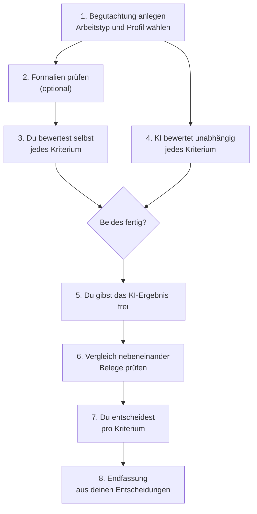
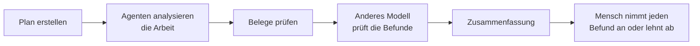

# ThesisHounds einfach erklärt

## Worum geht es?

ThesisHounds hilft Prüfenden an der DHBW, **wissenschaftliche Arbeiten** (PA1, PA2, Bachelorarbeit) zu begutachten. Dabei unterstützt eine **lokale KI**. Alles läuft auf dem eigenen Rechner, nichts geht in die Cloud.

Die wichtigste Regel: **Der Mensch bewertet, die KI ist nur eine Zweitmeinung.** Die KI vergibt keine Punkte und entscheidet nichts.

Die App hat zwei Bereiche mit ganz unterschiedlichem Zweck:

| | **Assessment** | **Runs** |
|---|---|---|
| Was ist das? | **Das Produkt.** Hier wird eine Arbeit wirklich begutachtet. | **Unsere Forschung.** Hier testen wir, wie gut verschiedene KI-Ansätze sind. |
| Wer bewertet? | Mensch **und** KI, unabhängig voneinander | Nur die KI |
| Für wen? | Für die Prüfenden | Für uns, für die Thesis |

---

## Assessment: So läuft eine Begutachtung ab

Stell dir vor, zwei Gutachter bewerten dieselbe Arbeit, **ohne vorher voneinander zu wissen**. Erst danach legen sie ihre Bewertungen nebeneinander. Genau das macht das Assessment, nur dass der zweite Gutachter eine KI ist.

Schritt 3 und 4 laufen **getrennt voneinander**. Die KI sieht deine Bewertung nie, und du siehst die KI-Ergebnisse erst nach Schritt 5.

### Schritt 1: Begutachtung anlegen
Du wählst, was du begutachtest (z. B. eine PA1) und welches **Profil** gilt. Ein Profil ist eine Liste von Bewertungskriterien, zum Beispiel "Fragestellung", "Methodik", "Quellen".

Das System prüft, ob alles zusammenpasst. Außerdem schaut es das Dokument kurz auf Auffälligkeiten durch, zum Beispiel eingeschleuste Anweisungen an die KI oder einen Sperrvermerk.

### Schritt 2: Formalien prüfen (optional)
Hier arbeitet **keine KI**, sondern feste Regeln. Das System prüft zum Beispiel Seitenzahl und Quellenqualität. Du entscheidest, was daraus folgt.

### Schritt 3: Du bewertest selbst
Du gehst **jedes Kriterium** durch und schreibst deine Einschätzung mit Begründung auf. Danach ist sie **eingefroren**. Sie wird nie an die KI weitergegeben, auch nicht versehentlich.

### Schritt 4: Die KI bewertet unabhängig
Parallel dazu geht die KI **jedes** Kriterium durch. Sie darf keines überspringen. Zu jeder Aussage nennt sie ein **Zitat** aus der Arbeit als Beleg.

Das System prüft dann mit einem simplen Textvergleich, ob dieses Zitat **wirklich so im Dokument steht** (siehe unten). Wenn bei einem einzigen Kriterium etwas schiefgeht, wird die ganze KI-Bewertung verworfen. Es gibt keine halben Ergebnisse.

Du siehst das Ergebnis aber noch nicht. Es wird zurückgehalten.

### Schritt 5: Du gibst das KI-Ergebnis frei
Das geht erst, wenn **beide** Bewertungen fertig sind. So verhindert das System, dass du dich von der KI beeinflussen lässt, bevor du dir ein eigenes Urteil gebildet hast.

### Schritt 6: Vergleich und Belegprüfung
Jetzt liegt dein Urteil neben dem der KI, Kriterium für Kriterium, mit Begründung, Beleg und Unsicherheit. Das System sagt nur grob, ob es Unterschiede gibt. **Ob ihr wirklich einer Meinung seid, entscheidest du.**

Du kannst:
- die Belege der KI direkt im Text nachschlagen,
- der KI Rückfragen stellen (deine Bewertung ändert das nicht),
- einzelne KI-Befunde als hilfreich oder unbrauchbar markieren.

### Schritt 7: Du entscheidest
Pro Kriterium nimmst du KI-Material an oder lehnst es ab. Entscheidungen werden nur ergänzt, nie überschrieben. So bleibt nachvollziehbar, was wann entschieden wurde.

### Schritt 8: Endfassung
Wenn alle Kriterien entschieden sind, entsteht der Entwurf. Er besteht **nur aus deinen Schlussfolgerungen** und den KI-Punkten, die du ausdrücklich übernommen hast. Beim Abschließen schreibt die KI **nichts** mehr dazu.

---

## Was bedeutet "Belege werden geprüft"?

Die KI muss zu jeder Aussage ein Zitat und eine Seite nennen. Das System prüft dann **ohne KI**, ob genau dieser Text auf genau dieser Seite steht.

| Ergebnis | Bedeutung |
|---|---|
| Zitat gefunden | Der Beleg existiert wirklich. |
| Zitat nicht gefunden | Die KI hat sich etwas ausgedacht oder falsch zitiert. |

**Wichtig:** Ein gefundenes Zitat heißt nur, dass die Textstelle existiert. Ob die KI sie **richtig verstanden** hat, prüft das System nicht. Das bleibt bei dir.

---

## Runs: Unsere Forschung

Hinter `/runs` steckt **kein Prüfwerkzeug**, sondern ein **Experiment für unsere Thesis**. Die Forschungsfrage lautet sinngemäß: *Lohnt sich ein komplizierter KI-Aufbau mit mehreren Agenten, oder reicht ein einfacher Auftrag an ein Modell?*

Dafür gibt es vier Varianten, die wir vergleichen:

| Modus | Was passiert |
|---|---|
| **A** | Ein einziger einfacher Auftrag an die KI |
| **B** | Mehrere spezialisierte Agenten mit einem gemeinsamen Modell |
| **C** | Wie B, aber verschiedene Modelle prüfen sich gegenseitig |
| **D** | Wie C, aber die Agenten werden je nach Arbeit selbst zusammengestellt |

Ein Run läuft so ab:

Hier arbeitet **nur die KI**. Es gibt keine menschliche Erstbewertung. Das ist Absicht, denn wir wollen messen, wie gut die KI allein ist, und die Varianten vergleichbar halten.

---

## Warum zwei getrennte Bereiche?

Wenn wir das Experiment (Runs) und das Produkt (Assessment) vermischen würden, wären beide kaputt:

- Das Produkt braucht einen **Menschen zuerst**, damit die KI ihn nicht beeinflusst.
- Das Experiment braucht eine **reine KI-Messung**, damit die Ergebnisse vergleichbar bleiben.

Deshalb sind beide Bereiche technisch getrennt und kennen die Daten des jeweils anderen nicht. Technisch steuert der Assessment-Bereich seine Schritte über eine einfache Zustandsverwaltung. Nur der Runs-Bereich nutzt LangGraph.

---

## Was du noch wissen solltest

- **Standardmäßig läuft die KI als Mock.** Die "Antworten" sind simuliert. Ein echter Lauf mit einem echten lokalen Modell wurde noch nicht nachgewiesen.
- **Nur synthetische Beispieldokumente.** Echte studentische Arbeiten sind gesperrt, bis Datenschutz, Recht und Hochschule das freigeben.
- **Alles liegt nur im Arbeitsspeicher.** Nach einem Neustart ist alles weg. Das ist gewollt, damit keine echten Daten gespeichert werden.
- **Keine KI-Punktevergabe.** Das System vergibt keine Noten oder Punkte.
- **Die Bewertungskriterien sind teils noch Beispiele.** Die offiziellen DHBW-Profile sind als Kandidaten hinterlegt und noch nicht bestätigt.
