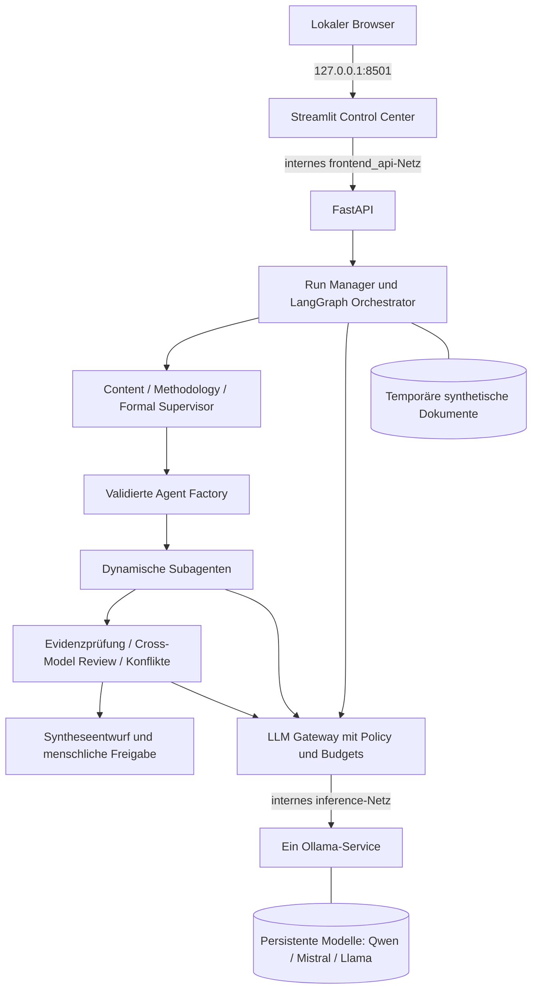

# ThesisHounds

**Document Security, 27.11.2026:** Der bestehende PDF-Eingang, Agenten-/Modellaufrufe
und der menschliche Review sind zusätzlich abgesichert. **737 Tests bestanden,
87,02 % kombinierte Coverage**. Quarantäne, serverseitige Tool-/Scopekontrollen
und neutrale Sicherheitsentscheidungen sind mit synthetischen Daten geprüft.
Echte Modellinferenz, vollständige OS-Workerisolation und Rendering/OCR sind
weiter offen; private Produktion bleibt gesperrt.
[Sicherheitsarchitektur](docs/security/prompt_injection.md) ·
[PDF-Grenzen](docs/security/pdf_security.md) ·
[Prüfprotokoll](docs/evaluation/security_results.md) ·
[Requirements-Matrix](docs/requirements/traceability.md).
Frühere Zahlen und Berichte darunter sind historische Stände; die aktuell
fehlenden Audit-/Remediation-Markdown-Dateien sind keine neuen Abnahmebelege.

**Semantische adaptive Planung 27.11.2026:** Der vorhandene Assessmentpfad kann
strukturierte lokale LLM-Pläne mit Methodengebrauch, freien Spezialistenaufgaben,
Kriterienbindung und Originalbelegen validieren. Regex bleibt eine explizite Baseline;
der Standardprovider simuliert weiterhin. **699 Tests, 87,37 % Coverage**.
Reale Modellqualität und notwendige Modell-/Katalogfreigaben bleiben offen.
[Architektur und A/B/C-Vergleich](docs/architecture/semantic_adaptive_planning.md) ·
[Prüfnachweise](docs/evaluation/semantic_planning_results.md).

**Post-Audit Remediation 27.11.2026:** Der kontrollierte PDF-Pfad ist mit dem
bestehenden AssessmentWorkflow und Ollama-Adapter verbunden. **672 Tests, 87,30 %
Coverage**; positive Modellantworten im Nachweis bleiben simuliert. Der reale
Pilot wartet weiterhin auf bestätigten PA1-Experimentkatalog, freigegebene
Modellartefakte und einen tatsächlichen lokalen Lauf. Standard: `INFERENCE_MODE=mock`.
Keine privaten Uploads oder Hochschulfreigabe. Aktueller Einstieg:
[Phasenbericht und Roadmap](docs/remediation/2026-11-27-remediation.md) ·
[G01–G30 Backlog](docs/remediation/2026-11-27-backlog.md) ·
[Prüfprotokoll](docs/remediation/2026-11-27-verification.md) ·
[Pilotanleitung](docs/remediation/2026-11-27-pilot-runbook.md).

**Historisch: Advanced Review 27.11.2026:** Lokales Kontextmanagement, strukturierte
Konsistenz-/Evidenzprüfung, bedarfsgebundene Eskalation, geschützte Provenance und
versioniertes Befundfeedback sind im bestehenden Reviewpfad integriert.
**627 Tests, 89,08 % Coverage**; Fairness/Ablation bislang ausschließlich mit Mocks.
[Audit](docs/architecture/advanced_review_audit.md) ·
[Ergebnisse und Grenzen](docs/evaluation/advanced_review_results.md).

**Security-Folgeaudit 27.11.2026:** Frontend-IP-Pinning, getrennte Modellbereitstellung,
Manifest-Digestprüfung, Bibliografie-IFC und Größen-/Zeitlimits ergänzt.
568 lokale Tests bestanden; bekannte offene Basisimagebefunde und Produktionsblocker
stehen im [Bericht dieser Sicherheitsiteration](docs/security/hardening_results.md).

**Mosbach-Erweiterung 27.11.2026:** Quellengebundene Kandidatenprofile für PA1/DS25,
PA2/DS24 und BA/DS23, lokale Knowledge-Base-/Metadatenimporte, Formalien-/Quellenprüfung
und menschliche Prüfentscheidungen sind ergänzt. Alle offiziellen Profile bleiben
bis zur bestätigten Gültigkeit/Freigabe Kandidaten; die Demo verwendet weiterhin
Beispielkriterien. Keine externen Recherche-APIs und keine echten Arbeiten freigegeben.
[Originalquellen/Anwendbarkeit](docs/dhbw/mosbach_sources.md) ·
[Import und Profile](docs/dhbw/assessment_profiles.md) ·
[lokale Quellenprüfung/GROBID-Grenzen](docs/research/citation_verification.md) ·
[Nachweise der Mosbach-Erweiterung](docs/evaluation/mosbach_results.md).

[](https://github.com/HerrBubimann/ThesisHounds/actions/workflows/ci.yml)

Lokale, datenschutzorientierte Infrastructure Foundation des DHBW-Projekts zur Begutachtung wissenschaftlicher Arbeiten. Version 0.2 erweitert FastAPI, Streamlit und einen gemeinsamen Ollama-Service um einen kontrollierten LangGraph-Workflow mit mehreren Modellen und dynamischen Subagenten.

Der Standard führt **synthetische Beispielanalysen mit Mockantworten** aus. Der unabhängige Bewertungs-MVP ergänzt menschliche Erstbewertung, kriteriumsweise Zweitbewertung, serverseitige Freigaben, Vergleich und menschliche Finalisierung. PA1/PA2/BA verwenden ausdrücklich inoffizielle Beispielprofile. Ein operatorgeprüfter PUBLIC-/synthetischer PDF-Pfad ist ergänzt; privater Upload, produktives RAG und Hochschulauthentifizierung stehen weiterhin aus. Ein echter positiver Modelllauf wurde für diesen Arbeitsstand nicht nachgewiesen.

**Sicherheitsstand 2026-11-26:** Der Standardbetrieb verwendet ausschließlich einen lokalen Mock ohne Netzwerkzugriff. Freie Chattexte und Analyseaufträge sind gesperrt; menschliche Kommentare bleiben RESTRICTED und werden nicht an Modelle weitergegeben. Die KI-Diskussion bleibt bis zur Freigabe gesperrt; ausdrücklich bestätigte menschliche Prüfung ohne Modell bleibt möglich. UNIVERSITY_SECURE und die externen Modi verweigern den Start. Echte Arbeiten bleiben bis zur Infrastruktur-, Rechts- und Organisationsfreigabe gesperrt. [Gap Analysis und Implementierungsplan](docs/security/gap_analysis.md), [Sicherheitsarchitektur](docs/security/privacy_architecture.md), [Tests](docs/security/privacy_test_results.md), [Produktionsblocker](docs/security/production_readiness.md).

Professorenfeedback: [Gap Analysis und Backlog](docs/architecture/professor_feedback_gap.md), [Umsetzungsstand](docs/architecture/implementation_status.md), [MVP-Anleitung](docs/architecture/assessment_mvp.md), [Hochschulbetrieb](docs/architecture/university_deployment.md), [Recherche](docs/research/state_of_the_art.md), [Risiken](docs/security/risk_register.md) und [offene Fragen](docs/stakeholders/open_questions.md). Öffentliche Recherche und KI-Punktevergabe bleiben deaktiviert. Die Sitzungsspeicherung ist flüchtig; echte studentische Arbeiten sind noch nicht freigegeben.

## Architektur

Wissenschaftliches Engineering: [Requirements Traceability](docs/requirements/traceability.md),
[Model Routing](docs/architecture/model_routing.md), [adaptive Agenten](docs/architecture/adaptive_agents.md),
[Evidence Validation](docs/architecture/evidence_validation.md) und
[Evaluationsergebnisse](docs/evaluation/results.md). Der kriteriumsweise MVP ergänzt
jetzt verpflichtende Coverage, kontrollierte Zusatzanalysen, adversariale Gegenprüfung
und einen Evidence Explorer. Das A–E-Evaluation-Lab läuft standardmäßig mit Mocks;
reale Modellqualität und menschliche Referenzbefunde bleiben ausdrücklich offen.



Im lokalen Compose-Stack sind beide Laufzeitnetze intern. Nur das Frontend veröffentlicht einen Loopback-Port. Die Modellbereitstellung verwendet kurzzeitig eine separate internetfähige Konfiguration und stoppt vorher die Analyseanwendung. Die separate Hochschulvariante benötigt ein durch die Hochschule abgesichertes Inferenznetz; siehe Betriebsanleitung.

## Voraussetzungen

- Python **3.12**, Git, Docker Engine/Desktop mit Linux-Containern und Compose ab v2.24. Container und CI verwenden Python 3.12.16.
- Windows: Docker Desktop mit WSL2-Backend und aktivierter Virtualisierung. Linux: Docker Engine und Compose-Plugin. macOS: Docker Desktop, CPU-Inferenz im vorliegenden Stack.
- Als Planungswert mindestens 16 GB verfügbarer RAM und etwa 30 GB freier Speicher für drei quantisierte Modelle, Images und Build-Caches. Der tatsächliche Bedarf ist modell- und hardwareabhängig.
- Internet zur Installation, für Image-Builds und Modelldownloads. Spätere Laufzeit kann ohne Internet erfolgen.
- Optional NVIDIA-GPU mit unterstütztem Treiber; unter Linux zusätzlich NVIDIA Container Toolkit. Docker auf macOS verwendet hier keine Metal-Beschleunigung.

## Schnellstart: Windows / PowerShell

Im Repository-Stamm ausführen. Eine vorhandene `.env` erhalten.

```powershell
Copy-Item .env.example .env
py -3.12 -m venv .venv
.\.venv\Scripts\python.exe -m pip install --require-hashes -r requirements-dev.lock
# Baut die Mock-Demo; keine Modellgewichte erforderlich:
docker compose build
# Offline starten:
docker compose up -d --no-build --pull never --wait --wait-timeout 180
.\.venv\Scripts\python.exe infrastructure/scripts/smoke.py --chat
.\.venv\Scripts\python.exe infrastructure/scripts/smoke.py --analysis --mode D
```

Im bereits von Codex vorbereiteten Checkout ist `.venv` vorhanden; die Installation muss dort nicht wiederholt werden. Dashboard: **[http://localhost:8501](http://localhost:8501)**; bei IPv6-Abweichungen `http://127.0.0.1:8501` verwenden. Im Control Center eine synthetische Analyse starten, den Agentenbaum verfolgen und Befunde anschließend menschlich prüfen.

## Schnellstart: Linux / macOS

```bash
cp .env.example .env
python3.12 -m venv .venv
.venv/bin/python -m pip install --require-hashes -r requirements-dev.lock
docker compose build
docker compose up -d --no-build --pull never --wait --wait-timeout 180
.venv/bin/python infrastructure/scripts/smoke.py --analysis --mode D
```

`provision.py` ist optional: Es verlangt dokumentierte Artefakt-/Lizenzfreigaben,
Version, Herkunft und vollständigen Digest. Die mitgelieferten Modelle besitzen
diese Freigabe nicht; Downloads werden deshalb verweigert. Die eigenständige
Provisioning-Zone startet keine Verarbeitungsdienste, berührt kein aktives
Modell-Volume und entfernt ihr Online-Netz im `finally`-Schritt.
[Details und Wiederherstellung](docs/setup.md#unterbrochene-bereitstellung).

## Konfiguration und Betriebsmodi

| Datei | Aufgabe |
| --- | --- |
| `config/models.yaml` | Modell-IDs, Hersteller, Provider, Rollen, Fähigkeiten, Kontext und Ressourcenschätzungen |
| `config/agents.yaml` | Modellzuordnung für Orchestrator, Synthese und drei Supervisoren; standardmäßig Content + Methodology |
| `config/execution.yaml` | Parallelität, Laufzeiten, Delegation, Token-/Aufrufbudgets und Aufbewahrung |
| `config/policies.yaml` | `LOCAL_ONLY`, Provider- und Werkzeug-Allowlist |
| `.env` | Ports, HTTP-Timeouts und Container-CPU-/RAM-Limits; `LLM_MODEL` für den bestehenden Einzelchat |

Compose bindet `config/` schreibgeschützt ein. Nach Konfigurationsänderungen das Backend mit `docker compose restart backend` neu starten; das beendet laufende Analysen. Nach Änderungen an `.env` ist `docker compose up -d` erforderlich. Ein Modellwechsel benötigt zusätzlich eine erneute Bereitstellung. Optionale Gemma-, DeepSeek- oder Phi-Modelle können als weitere lokale Registry-Einträge ergänzt werden; deren Schema- und Kontextkompatibilität muss separat getestet werden.

Standardlimits: drei Supervisoren, sechs Subagenten, zwei aktive Agenten, **ein Modellaufruf gleichzeitig**, Delegationstiefe zwei, maximal drei Iterationen pro Subagent, 32 Modellaufrufe und 100000 konservativ reservierte Tokens pro Analyse. Das Laufzeitlimit beträgt eine Stunde. Standardmäßig wird das Modell nach jedem Aufruf entladen, um CPU-/GPU-Speicher freizugeben; dies kostet Ladezeit. Details und zulässige Konfigurationsgrenzen stehen in [Architektur](docs/architecture.md).

`LOCAL_ONLY` bleibt die aktivierbare Datenschutzpolicy. Davon getrennt wählt `DEPLOYMENT_MODE` zwischen lokaler und explizit freigegebener hochschulinterner Ollama-Infrastruktur. `EXPERIMENTAL` wird weiterhin abgewiesen. Externe Provider sind nur vorbereitete Erweiterungspunkte; es gibt keinen externen Fallback und keine aktivierbare Cloud-Anbindung.

## Evaluationsmodi

| Modus | Ausführung |
| --- | --- |
| A | Ein LLM-Aufruf liefert Befunde mit einem einfachen Prompt. |
| B | Statische Hierarchie mit einem gemeinsamen LLM, ohne Cross-Model Review. |
| C | Statische Hierarchie mit verschiedenen Herstellern und Cross-Model Review. |
| D | Dynamische AgentSpecs, verschiedene Hersteller, Cross-Model Review und deterministische Belegprüfung. |

Alle Modi verwenden dieselben synthetischen Seiten und frei wählbare Bewertungskriterien. Ein gefundener Textbeleg beweist keine fachliche Richtigkeit. Modellzustimmung ist kein Wahrheitsbeweis. Details zu Messgrößen und notwendigen menschlichen Referenzbewertungen: [Evaluation](docs/evaluation.md).

## GPU, Stoppen und Neustart

```bash
docker compose -f compose.yaml -f compose.gpu.yaml up -d --no-build --pull never --wait --wait-timeout 180
docker compose -f compose.yaml -f compose.gpu.yaml exec ollama ollama ps
# Mit dem Python-Interpreter der virtuellen Umgebung ausführen:
python infrastructure/scripts/smoke.py --gpu --analysis --mode D
docker compose -f compose.yaml -f compose.gpu.yaml down
```

CPU-Stack stoppen: `docker compose down`. Modelle bleiben erhalten; **`down -v` löscht das Modell-Volume**. Analyseläufe, Befunde und menschliche Entscheidungen sind absichtlich flüchtig und gehen bei Backend-Neustart verloren. Ein Modellwechsel benötigt keinen separaten Ollama-Container.

## Tests und CI

Dieselben Pflichtprüfungen wie in GitHub Actions laufen auch lokal. Es werden keine echten LLMs und keine GPU benötigt, alle Modellantworten sind Mocks.

```bash
make ci                 # lint, format-check, alle Tests mit Coverage, security, docker-check
make test-unit | test-integration | test-security | test
make lint | format-check | coverage | security | docker-check
make docker-smoke       # benötigt Docker: Images bauen, Stack mit Mock-LLM, End-to-End-Test
make format             # Ruff-Autofix und Formatierung
```

Ohne `make` (z. B. Windows) gelten dieselben Ziele direkt:

```powershell
.\.venv\Scripts\python.exe infrastructure/scripts/run_ci.py ci
.\.venv\Scripts\python.exe infrastructure/scripts/run_ci.py test-unit coverage
```

Unter Linux/macOS `.venv/bin/python` verwenden. Berichte landen in `reports/` (JUnit, `coverage.xml`, `coverage/html/index.html`, Scannerberichte). Bandit und pip-audit werden beim ersten Aufruf von `security` aus `requirements-security.lock` in `.tools/scanners` installiert. Gitleaks und Trivy laufen lokal nur, wenn sie installiert sind, und werden sonst als `SKIPPED` ausgewiesen. In der CI sind sie verpflichtend.

### Pull-Request-Prozess und verpflichtende Checks

1. Feature-Branch von `main` anlegen, Änderungen mit Tests umsetzen, `make ci` ausführen.
2. Pull Request auf `main` öffnen und das [Template](.github/pull_request_template.md) ausfüllen.
3. Die [CI-Pipeline](docs/ci-cd.md) läuft automatisch: Code Quality, Unit-, Integrations- und Sicherheitstests, Coverage, Bandit, pip-audit, Gitleaks, Docker-Validierung, Image-Build mit Trivy-Scan und Runtime-Smoke-Tests.
4. Verpflichtender Status Check ist **`thesishounds-ci-gate`**. Er ist nur grün, wenn jeder Job erfolgreich war. Fehlgeschlagene, abgebrochene oder übersprungene Jobs, fehlende Testberichte und übersprungene Tests lassen ihn fehlschlagen.
5. Merge erst nach grünem Gate, einer Freigabe durch ein anderes Teammitglied und aufgelösten Review-Kommentaren. Der Branch muss auf dem Stand von `main` sein.

> **Hinweis:** Das GitHub-Ruleset, das diese Regeln erzwingt, ist vorbereitet ([`github_ruleset.json`](infrastructure/scripts/github_ruleset.json)), aber erst wirksam, wenn ein Repository-Admin es angelegt hat. Siehe [Einrichtung](docs/ci-cd.md#github-ruleset-für-main).

Verbindliche Teamregeln: [docs/contributing.md](docs/contributing.md).

### Coverage-Anforderungen

Die kombinierte Coverage (Zeilen + Branches) aller Testsuites muss mindestens **80 %** betragen (`fail_under` in `pyproject.toml`). Gemessen wurden am 26.11.2026 85,1 %. Der Wert wird nur erhöht, nie abgesenkt.

### Fehlerbehebung bei fehlgeschlagenen Pipelines

| Job rot | Vorgehen |
| --- | --- |
| Code Quality | `make format`, danach `make lint` |
| Unit/Integration/Security Tests | Job Summary und Artefakt `*-test-report` ansehen, lokal `make test-unit` usw. |
| Test Coverage | Tests ergänzen; HTML-Bericht im Artefakt `coverage-report` |
| Security Checks | Artefakt `security-scan-report`; Abhängigkeit aktualisieren, Secret widerrufen. Ausnahmen nur nach [Verfahren](docs/ci-cd.md#ausnahmen) |
| Docker Validation/Build | `make docker-check` bzw. `make docker-smoke`; Trivy-Berichte im Artefakt `docker-scan-report` |
| nur Quality Gate | Gate-Summary nennt fehlende Berichte oder übersprungene Tests |

Weitere Fälle: [docs/ci-cd.md#fehlerbehebung](docs/ci-cd.md#fehlerbehebung). Echte Inferenz, GPU und Offline-Abnahme erfolgen auf Zielhardware mit dem Smoke-Script. Der tatsächlich ausgeführte Prüfumfang ist in [validation.md](docs/validation.md) dokumentiert.

## API und Dokumentation

Die bisherigen Endpunkte `/health`, `/api/v1/status`, `/api/v1/models` und `/api/v1/chat` bleiben erhalten. Die lokale Modellliste unter `/models` behält ihren Vertrag; `/models/status` ergänzt Registry-, Hersteller- und Verfügbarkeitsinformationen.

Neu: `/api/v1/agents`, `/agents/{agent_id}`, `/runs`, `/runs/{run_id}`, `/runs/{run_id}/graph`, `/runs/{run_id}/findings`, `/runs/{run_id}/cancel`, `/findings/{finding_id}/review` und `/system/resources`. Methoden und Beispiele: [Setup und API](docs/setup.md).

- [Architektur, Workflow und Erweiterungspunkte](docs/architecture.md)
- [Sicherheit und bekannte Grenzen](docs/security.md)
- [Entwicklungsumgebung, DHBW-Server und Fehlerbehebung](docs/setup.md)
- [Wissenschaftliche Evaluation](docs/evaluation.md)
- [Prüfstand und offene Abnahme](docs/validation.md)
- [CI/CD-Pipeline, Sicherheitsschwellen und Ruleset](docs/ci-cd.md)
- [Entwicklungsregeln für das Team](docs/contributing.md)

Lokale Verarbeitung macht das System **nicht automatisch DSGVO-konform**. Das aktuelle MVP besitzt keine Benutzeridentifikation und ist keine freigegebene Mehrbenutzeranwendung. Vor vertraulicher oder produktiver Nutzung sind Datenschutzbewertung, Authentifizierung, Zugriffsrechte, Verschlüsselung, Löschung und Betriebsfreigabe erforderlich.
