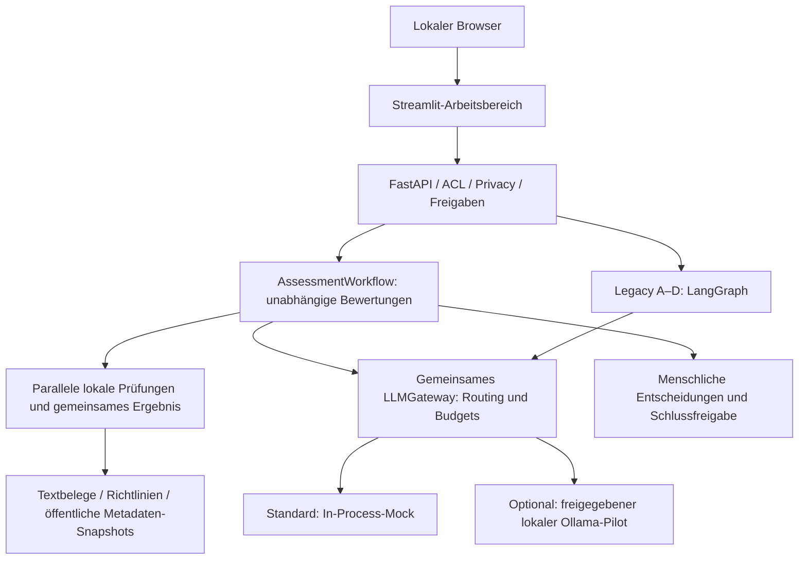

# ThesisHounds

[](https://github.com/HerrBubimann/ThesisHounds/actions/workflows/ci.yml)

Lokale Entwicklungsbasis zur unabhängigen Zweitbegutachtung von PA1, PA2 und
Bachelorarbeiten. **Version 0.2.0, Dokumentationsstand 28.11.2026.**
FastAPI bleibt Sicherheitsinstanz; Streamlit stellt den Gutachterarbeitsbereich
bereit. Ein separater LangGraph-Ablauf dient den gekennzeichneten Legacy-Experimenten.

**Standard ist Mock-Inferenz mit synthetischen Daten.** Ein kontrollierter Pilot
kann unabhängig geprüfte öffentliche PDFs und freigegebene lokale Modellartefakte
verwenden. Vertrauliche Arbeiten, Hochschul-SSO, produktiver Mehrbenutzerbetrieb,
externe KI, dokumentbezogene öffentliche Recherche und KI-Punktevergabe sind gesperrt.
Beispielkriterien sind keine offiziellen DHBW-Kataloge.

## Unterstützter Begutachtungsablauf

1. Über **Neue Begutachtung** Arbeitstyp, Studiengang, Jahrgang, zugelassenes Dokument
   und Bewertungskatalog wählen; Testdatengrenze und Anlage ausdrücklich bestätigen.
2. Dokument lesen und menschliche Erstbewertung je Pflichtkriterium verfassen oder eine
   lokale JSON-/YAML-/PDF-/DOCX-Importvorschau prüfen und ergänzen. Entwürfe können
   ausdrücklich in der Browsersitzung gespeichert werden; die Erstfreigabe wird als
   eigener integritätsgeprüfter, flüchtiger Bewertungsstand erhalten.
3. Unabhängige KI-Prüfung starten. Sie erhält keine menschliche Erstbewertung; Ergebnisse
   bleiben bis zum Abschluss beider Bewertungen und ausdrücklicher Vergleichsfreigabe verborgen.
4. Mensch-/KI-Einschätzungen neutral vergleichen, Befunde und Originalzitate prüfen,
   Rückfragen und Notizen dokumentieren und pro Kriterium menschlich entscheiden.
5. Deterministischen Gutachtenentwurf prüfen und ausdrücklich abschließen.
   TXT-/Markdown-Export ist lokal; PDF-/DOCX-Gutachtenexport ist nicht angebunden.

Die RESTRICTED-KI-Diskussion bleibt durch die Backendpolicy gesperrt. Eine
dokumentierte menschliche Prüfung ohne Modell ist möglich. Ein Zitat, Metadatentreffer
oder Modellkonsens beweist keine fachliche Richtigkeit.

Alternativ lässt sich bei der Anlage **MANUAL_ONLY** wählen: Erstbewertung,
kriterienspezifische Schlussentscheidungen und Finalisierung ohne Modellaufruf.
Dieser Modus öffnet keine KI-Funktionen. Die API verlangt bei der Anlage
`profile_confirmed: true`; Dokument-/Katalogwechsel und veränderte Erstbewertungen
sperren die weitere Offenlegung. RAM-Snapshots sind keine revisionssichere Archivierung.

[Einfach erklärt](Erklärungs.md) · [vollständiger Ablauf](docs/frontend/review_workflow.md) ·
[Anlage, API und Pilotvoraussetzungen](docs/setup.md)

## Architektur und Funktionen



- Pflichtkriterien, kontrollierte semantische Spezialistenplanung, begrenzte
  unabhängige Modellgegenprüfung und dokument-/profilgebundene Provenance.
- Sechs begrenzte parallele Prüfpfade: wissenschaftliche Bewertung, Formalien/Quellen,
  Sprache, Retrieval, Zitierformat und numerische Konsistenz. Optionale Dienste brauchen
  eigene lokale Artefakte und Freigaben; Ausführungserfolg ist keine Qualitätsbestätigung.
- Konservative Reproduzierbarkeitsfragen, kontextgebundene Zahlenhinweise, lokale
  Dublettenvorschläge, versionierte Gutachternotizen und explizite Sitzungszeitmessung.
- Offlineimporte öffentlicher Metadaten einschließlich kontrollierter RIS-/CSL-Exporte,
  versionierter SQLite-/FTS5-Bestände und getrenntem öffentlichem Sync-Prozess.
- Quelleninspektor, Mosbach-Richtlinienvorschau und geschützter Original-PDF-Viewer.
  Ohne bestätigte PDF-Geometrie werden keine visuellen Belegkoordinaten erfunden.
- A–E-Evaluationslabor und Modellbenchmark als CLI. Das UI besitzt keine
  Benchmark-Report-API und zeigt keine erfundenen Messwerte.

[Architektur](docs/architecture.md) · [Frontend](docs/frontend/architecture.md) ·
[Prüfwerkzeuge](docs/research/reviewer_productivity_tools_2026-11-28.md) ·
[Evaluation](docs/evaluation.md)

## Voraussetzungen und Schnellstart

Für den Containerbetrieb: Docker mit Linux-Containern und Compose mit Unterstützung
für [`!reset` / `!override`](https://docs.docker.com/reference/compose-file/merge/).
Für native Entwicklung zusätzlich **Python 3.12**, Git und
eine eigene virtuelle Umgebung. Docker/CI pinnen Python **3.12.16**; der zuletzt
geprüfte Windows-Interpreter war **3.12.6**. Alle direkten Python-Abhängigkeiten sind
gepinnt; Installation erfolgt aus Hash-Locks.

Der folgende Einstieg baut nur Backend und Frontend und ersetzt Ollama durch den
vorhandenen, deutlich gekennzeichneten CI-Mock. Keine Modellgewichte nötig:

```powershell
# Im Repository-Stamm; vorhandene .env nicht überschreiben:
if (-not (Test-Path -LiteralPath '.env')) { Copy-Item .env.example .env }
docker compose build backend frontend
docker compose -f compose.yaml -f compose.ci.yaml up -d --no-build --pull never --wait --wait-timeout 180
```

Unter Linux/macOS die erste Zeile durch
`test -f .env || cp .env.example .env` ersetzen. Danach dieselben Dockerbefehle.
Oberfläche: **[http://localhost:8501](http://localhost:8501)**.
Beenden: `docker compose -f compose.yaml -f compose.ci.yaml down`.

Die zuvor gestartete Vorschau nutzt das getrennte Projekt
`thesishounds-frontend-preview`. Falls sie noch läuft, verwaltet man sie mit
`docker compose -p thesishounds-frontend-preview -f compose.yaml -f compose.ci.yaml …`.
Nicht gleichzeitig einen zweiten Stack auf denselben Port/Netzbereich starten.

Für den regulären Stack mit echtem, zunächst modelllosem Ollama-Service:
`docker compose build` und anschließend
`docker compose up -d --no-build --pull never --wait --wait-timeout 180`.
Auch dort bleibt `INFERENCE_MODE=mock` der Standard.
Modellbereitstellung, GPU, Offline-/Hochschulbetrieb und native Entwicklung:
[Setup](docs/setup.md). Verfügbare Hardware und tatsächliche Modellanforderungen
müssen separat geprüft werden; Registry-Ressourcenwerte sind Schätzungen.

## Konfiguration und Sicherheitsgrenzen

| Datei / Bereich | Aufgabe |
|---|---|
| `config/models.yaml`, `config/agents.yaml` | Modelle, Rollen, Artefaktnachweise und manuelle Zuordnungen |
| `config/model_capabilities.yaml` | derzeit leere empirische Fähigkeitsmatrix |
| `config/execution.yaml` | Agenten-/Modellparallelität, Kontext, Budget, Timeout und Aufbewahrung |
| `config/policies.yaml` | LOCAL_ONLY und feste Provider-/Werkzeuggrenzen |
| `config/assessment_profiles/` | inoffizielle PA1-/PA2-/BA-Beispielkataloge |
| `config/institutions/dhbw/mosbach/` | versionierte Quellen und noch nicht aktivierte institutionelle Kandidaten |
| `.env` / `.env.example` | lokale Betriebsparameter; keine Berechtigung zur Produktionsfreigabe |
| `frontend/.streamlit/config.toml` | lokales Theme und ausgeschaltete Nutzungstelemetrie |

Standard: zwei parallele Agenten/Prüfaufgaben, **ein Modellaufruf gleichzeitig**,
ein aktiver Lauf, sechs dynamische Agenten, maximal zwei neu geplante Spezialisten,
32 Modellaufrufe und 100000 konservativ reservierte Tokens. TTL: 3600 Sekunden,
maximal 20 aufbewahrte Datensätze je Runtime-Speicher.

Bewertungen und Entscheidungen sind flüchtig und gehen beim Backendneustart verloren.
Sitzungsentwürfe sind kein dauerhafter Speicher. Dokument-/Snapshot-/Artefaktstores
müssen außerhalb des Repositorys liegen. Nur das Frontend veröffentlicht einen
Loopback-Port; Netze der Verarbeitungsdienste bleiben intern. Produktionsmodi
verweigern den Start. Die gemeinsame Demo-Identität ist keine Hochschulanmeldung.

## Entwicklung und Validierung

```powershell
py -3.12 -m venv .venv
.\.venv\Scripts\python.exe -m pip install --require-hashes -r requirements-dev.lock
.\.venv\Scripts\python.exe infrastructure/scripts/run_ci.py ci
```

POSIX: `.venv/bin/python` verwenden. Weitere Ziele stehen im
[Makefile](Makefile) und in [CONTRIBUTING](docs/contributing.md).
`run_ci.py ci` umfasst nicht den vollständigen GitHub-Workflow: zusätzliche
Privacy-Benchmarks, npm-Audit, Trivy und Runtime-Smoke werden dort getrennt ausgeführt.
Die kombinierte Coverage-Grenze bleibt **80 %**. Required Check:
**`thesishounds-ci-gate`**, acht Pflichtjobs plus Gate.

Aktueller lokaler Testnachweis vom 28.11.2026: **1005 Tests bestanden,
86,77 % kombinierte Coverage**. Das Human-First-Gate wurde um vollständige
Integritäts-/Versionsbindungen, kontrollierte Importvorschauen, ein menschliches
Entscheidungsledger und einen rein menschlichen Ablauf erweitert. Ruff, Syntaxprüfung,
Bandit, Datenschutzscan und Docker-Konfigurationsprüfung bestanden.
Backend-/Frontend-Build, Container-E2E, Browserprüfung und Imagescans stammen aus
der vorherigen Frontenditeration. Unfixierte Basisimagebefunde und institutionelle
Freigaben bleiben offen; ein erfolgreicher Remote-CI-Lauf ist damit nicht belegt.

[Prüfstand](docs/validation.md) · [CI und Merge-Schutz](docs/ci-cd.md) ·
[Sicherheit](docs/security.md) · [Produktionsblocker](docs/security/production_readiness.md)

## Dokumentationswegweiser und Historie

- [Requirements und Umsetzungsstand](docs/requirements/traceability.md)
- [Human-First-Audit, Umsetzung und Testnachweise](docs/architecture/human_first_assessment.md)
- [Automation Bias: Forschungsgrundlage](docs/research/automation_bias.md)
- [Kontrolliertes Reliance-Studienprotokoll](docs/evaluation/human_ai_reliance.md)
- [DHBW-Quellen und Anwendbarkeit](docs/dhbw/mosbach_sources.md)
- [Lokale wissenschaftliche Infrastruktur](docs/research/local_scientific_infrastructure.md)
- [Offene Hochschulfragen](docs/stakeholders/open_questions.md)
- [Frontendnachweise und verbleibende Grenzen](docs/frontend/limitations.md)

Historische Iterationen bleiben in den jeweiligen Berichten erhalten:
[Advanced Review: 627 Tests](docs/evaluation/advanced_review_results.md),
[semantische Planung: 699 Tests](docs/evaluation/semantic_planning_results.md),
[Dokumentsicherheit: 737 Tests](docs/evaluation/security_results.md),
[parallele Prüfungen: 878 Tests](docs/evaluation/parallel_review_results.md),
[Gutachterwerkzeuge: 934 Tests](docs/evaluation/reviewer_productivity_results.md).
Nicht vorhandene Remediation-Dateien werden nicht als aktuelle Anleitung verlinkt.
Ein bestätigter offizieller Detailkatalog, reale Modellqualität und institutionelle
Freigaben werden durch diese Entwicklungsnachweise nicht ersetzt.
