# Architektur und Entscheidungen

## Bestehende Foundation und neue Komponenten

FastAPI, Streamlit und ein gemeinsamer Ollama-Service bleiben die einzigen drei Compose-Services. Das Backend läuft als einzelner Prozess. Die vorhandene `LLMService`-Klasse ist jetzt eine kompatible Fassade über das gemeinsame Gateway; sie besitzt keinen separaten Inferenzpfad.

| Pfad | Verantwortung |
| --- | --- |
| `llm/providers/base.py` | Provider-Protokoll: Completion, Structured Output, Health, Modell-/Capability-Discovery, Ressourcen |
| `llm/providers/ollama.py` | Ollama-HTTP-Adapter, Timeouts, Fehlerbereinigung, Modellprüfung, Tokenmetadaten |
| `llm/model_registry.py` | Validierte YAML-Modellkonfiguration und Rollenfreigaben |
| `llm/gateway.py` | Policy je Aufruf, Kontext-/Tokenreservierung, gemeinsames Inferenzsemaphore, strukturierte Antwortvalidierung |
| `core/configuration.py` | Validierung und Abgleich der vier Konfigurationsdateien |
| `core/task_planner.py` | Planprüfung, erlaubte Supervisoren, Mindestbesetzung, azyklische Abhängigkeiten |
| `core/orchestrator.py` | Master Orchestrator und fester LangGraph mit sieben Schritten |
| `core/execution_engine.py` | Agentensemaphore, Zustandsübergänge, Zeitlimits und begrenzte Wiederholungen |
| `core/runtime.py` | Hintergrundläufe, Abbruch, Aufbewahrung, Freigabe und lokale Ressourcenmessung |
| `agents/agent_factory.py` | Prüfung von Modellvorschlägen und Instanziierung erlaubter Agenten |
| `agents/agent_registry.py` | Agentenstatus, Beziehungen, Laufzeit, Modellaufrufe und Bereinigung |
| `validation/` | Belegprüfung, unabhängige Modellreviews und Konfliktmarkierung |
| `security/` | Zentrale Daten-/Provider-Policy und feste Werkzeug-Allowlist |
| `services/document_store.py` | Lokales temporäres Dokumentformat und serverseitige synthetische Fixture |
| `monitoring/resources.py` | Lokale OS-/Prozessmetriken ohne Exporter |
| `schemas/domain.py` | Gemeinsame Pydantic-Verträge für Planung, AgentSpecs, Läufe, Befunde und Reviews |
| `api/control.py` | Neue Control-Center-Endpunkte |

Die drei Supervisoren sind konfigurierte Instanzen derselben Ausführungsinfrastruktur. Eine AgentSpec ist eine beschränkte Beschreibung, kein ausführbarer Code. Deshalb gibt es keine leeren `base_agent.py`-, Supervisor- oder Subagenten-Unterklassen. Der echte LangGraph befindet sich beim Orchestrator statt in einem zusätzlichen leeren Workflow-Paket.

## Kontrollierter Durchlauf

```mermaid
flowchart LR
    Plan[Plan erstellen und DAG prüfen] --> Delegate[Supervisoren / AgentSpecs]
    Delegate --> Analyze[Subagenten innerhalb Limits ausführen]
    Analyze --> Evidence[Belege deterministisch prüfen]
    Evidence --> Review[Review durch anderen Hersteller]
    Review --> Conflict[Konflikte / begrenztes drittes Review]
    Conflict --> Synthesis[Syntheseentwurf]
    Synthesis --> Human[Menschliche Prüfung über API / UI]
```

Das LLM kann ausschließlich strukturierte Plan- und AgentSpec-Daten liefern. Es kann keine Graphkanten, Konfiguration, Berechtigungen, Netzwerkziele oder Budgets ändern. Der Master wählt konfigurierbare Supervisoren; standardmäßig müssen Content und Methodology im Plan enthalten sein. Formal ist zusätzlich verfügbar. Supervisor-Tasks können Abhängigkeiten enthalten; zyklische oder unbekannte Abhängigkeiten werden abgewiesen. Erstellung und tatsächliche Analyse folgen der geprüften Reihenfolge. Ergebnisse abhängiger Tasks werden in diesem MVP nicht automatisch als Kontext an Nachfolger übergeben.

Im Modus D schlägt jeder Supervisor konkrete AgentSpecs vor. Die Factory prüft Schema, bekannte Modell-ID, freigegebene Rolle, Supervisor-Zuordnung, Kategorie, Werkzeuge, Laufzeit und Delegationstiefe. IDs erhalten serverseitig ein Run-Präfix; doppelte IDs werden abgewiesen. Auch bereits konstruierte Pydantic-Instanzen werden erneut validiert.

Orchestrator ist Ebene 0, Supervisoren Ebene 1, spezialisierte Subagenten Ebene 2. Subagenten besitzen keine weitere Delegationsberechtigung. `document.read` bezeichnet ausschließlich den bereits zum Lauf gehörenden Dokumentkontext. Es gibt keine freie Dateipfadauflösung und keinen modellgesteuerten Tool-Dispatcher. Eingabe-/Ausgabeschema sind feste IDs `document.v1` und `findings.v1`, keine beliebig ausführbaren Schemas.

## Ausführung, Budgets und Abbruch

Die YAML-Dateien werden beim Backend-Start geladen. Standardwerte: höchstens drei Supervisoren, sechs spezialisierte Agenten, zwei gleichzeitig ausführende Agenten, ein aktiver Run, ein gleichzeitiger Modellaufruf. Die drei Supervisorrollen und zwei Hierarchieebenen bilden die Sicherheitsobergrenze dieser Version. Innerhalb der validierten Grenzen lassen sich Limits konfigurieren; größere Parallelitäts-/Subagentenzahlen erfordern eine bewusste Anpassung der Standardwerte und ausreichende Ressourcen.

Das Gateway besitzt ein gemeinsames Semaphore für sämtliche Agenten und den Einzelchat. Bei `sequential_model_loading: true` wird exakt ein Inferenzaufruf zugelassen und Ollama erhält `keep_alive: 0`. Bei `false` werden höchstens `max_parallel_model_calls` zugelassen und ein Modell darf fünf Minuten geladen bleiben. Zusätzlich begrenzen Ollamas `OLLAMA_NUM_PARALLEL` und `OLLAMA_MAX_LOADED_MODELS` die tatsächliche Last. Das ist kein VRAM-Scheduler mit Speicherprognose; Ressourcenschätzungen der Registry sind Planungswerte.

Jeder Analyseaufruf reserviert vor Inferenz ein Aufrufkontingent sowie ein konservatives Tokenkontingent aus UTF-8-Eingabelänge, Schema, Puffer und Ausgabelimit. Auch ein Versuch, der bereits an der Modellverfügbarkeitsprüfung scheitert, zählt zum Budget. Reservierungen werden nach Fehlern nicht zurückgegeben. Provider-Tokenzahlen werden separat erfasst; fehlende Zahlen werden ausdrücklich als unvollständig markiert. Die bytebasierte Reservierung ist keine exakte Modelltokenisierung. Sie kann Anfragen früher ablehnen, als die tatsächliche Tokenzahl es erfordern würde. Kontextgrenzen gelten ebenfalls vor dem Aufruf.

Wiederholungen erfolgen nur für Schema-/Upstreamfehler und Timeouts, höchstens `min(AgentSpec.max_iterations, max_iterations, max_retries + 1)` Mal. Jede Wiederholung verbraucht Budget. Modell-, Policy- und Budgetfehler erzeugen keine unbegrenzte Schleife. Ein globales Zeitlimit umfasst den gesamten Lauf; Agenten erhalten zusätzlich eigene Zeitlimits. TaskGroups brechen bei einem fehlgeschlagenen Analysezweig die Geschwister ab; Teilergebnisse bleiben sichtbar.

Abbruch beendet wartende/aktive Backend-Tasks und HTTP-Anfragen. Eine sofortige Beendigung bereits laufender nativer Inferenz innerhalb Ollamas wird damit nicht garantiert. Nach Abbruch werden keine weiteren Workflow-Modellaufrufe gestartet. Vor Worker-Start abgebrochene Läufe sind ebenfalls erfasst.

## Reviews, Evidenz und finale Ausgabe

Ein Review muss von einem anderen konfigurierten Hersteller stammen als der ursprüngliche Befund. Die Auswahl versucht freigegebene unabhängige lokale Modelle; sie wechselt niemals zu einem externen Provider. Wenn niemand verfügbar ist, bleibt `review_status=MISSING` mit einer Warnung sichtbar. Ein Review bewertet Nachvollziehbarkeit, Beleg, fachliche Berechtigung, fehlenden Kontext und mögliche Halluzination; das bleibt eine Modellmeinung.

Ein Textbeleg erhält `VALIDATED`, wenn das wörtliche Zitat auf der angegebenen synthetischen Seite vorkommt. Das bewertet ausschließlich die Existenz des Zitats. Fehlende oder erfundene Zitate werden `REJECTED`. Bei Abwesenheitsbehauptungen wird vollständiger Dokumentkontext verlangt; auch dann bleibt semantische Abwesenheit `NOT_CHECKED`, statt sie mechanisch als bewiesen auszugeben.

Konflikte umfassen negative/unsichere Reviews und konservative Kandidaten mit entgegengesetzter Bewertung auf derselben Seite/Kategorie. Dies ist keine vollständige semantische Widerspruchserkennung. Ein begrenztes drittes Herstellerreview darf zusätzlichen Kontext liefern, entfernt die Konfliktmarkierung jedoch nicht. Beide Befunde und alle Modellmeinungen bleiben erhalten. Nach menschlichem Bearbeiten werden ursprünglicher Befund und überholte Reviews aufbewahrt, während aktuelle Modell-/Evidenzfreigaben zurückgesetzt werden.

Nach der Synthese wartet der Run auf menschliche Prüfung. Erst nach einer Entscheidung über jeden Befund wird eine finale Zusammenstellung aus den akzeptierten Befunden erzeugt. Der LLM-Syntheseentwurf fließt nie automatisch in die finale Ausgabe ein. Menschen können auch einen maschinell ungeklärten Befund explizit akzeptieren; der Prüfstatus bleibt in der Zusammenstellung sichtbar. Eine rechtssichere Identifikation des freigebenden Menschen ist noch nicht implementiert.

## Zustand und Monitoring

Läufe, Befunde, Agenten und Entscheidungen liegen im Arbeitsspeicher eines Backend-Prozesses. LangGraph nutzt keine Cloud, keinen Checkpointer und keine externe Zustandspersistenz. Prozessneustart verliert den Laufzustand. Keine mehreren Uvicorn-Worker oder Replikate verwenden. Standardmäßig werden abgeschlossene Ausführungen nach einer Stunde entfernt, auch wenn menschliche Freigabe noch aussteht; bei neuen Läufen kann die Grenze von 20 aufbewahrten Läufen ältere abgeschlossene Ausführungen verdrängen.

Temporäre Dokumentdateien liegen im Backend-tmpfs bzw. bei nativer Entwicklung unter `.runtime/documents`. Nur serverseitig erzeugte synthetische Dokumente können angelegt werden. Die Ingestion-Schnittstelle für echte Dokumente ist noch nicht öffentlich. Die Bereinigung entfernt die zum Run gehörende Datei, Agenten und Befunde; beim geordneten Shutdown werden Dokumentdateien entfernt. Ein hart beendeter nativer Prozess kann synthetische Restdateien hinterlassen.

OS-CPU/RAM, Backend-RSS und während der Ausführung verfügbare Ollama-Modell-VRAM-Werte werden lokal abgetastet. Pro Run bleiben höchstens 128 Messpunkte sowie beobachtete Spitzenwerte erhalten. Stufenwechsel ergänzen Messpunkte. Kurze Spitzen können zwischen Messpunkten liegen. OS-Werte sind nicht nach Container oder Analyse isoliert; `/api/ps` meldet Modell-VRAM, keine vollständige GPU-Auslastung oder Gesamtkapazität. Prometheus/Grafana können später die Metrics-Schnittstelle ergänzen, sind keine zusätzlichen Services dieser Version.

Offizielle Schnittstellen: [LangGraph Graph API](https://docs.langchain.com/oss/python/langgraph/graph-api), [Ollama Chat und Structured Output](https://docs.ollama.com/api/chat), [Ollama laufende Modelle](https://docs.ollama.com/api/ps).
