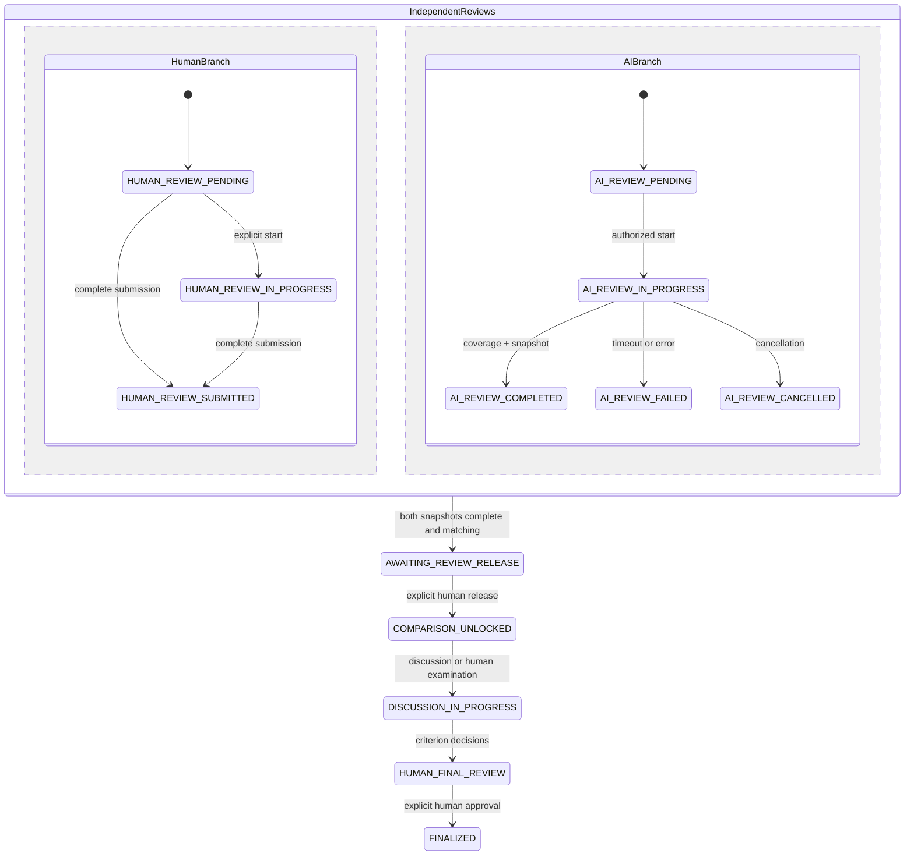

# Human-first assessment: implementation plan and security boundary

Scope: the original ThesisHounds task and professor feedback require an independent,
human-controlled scientific second reviewer for PA1, PA2 and BA. Extend
`AssessmentWorkflow`; do not create another assessment store or model gateway.

Audit (2026-11-28), prioritized work:

1. P0: reject whitespace-only human judgments and decisions; bind confirmed catalog,
   document and independent review snapshots; recheck the gate on every disclosure.
   Existing `min_length=1` accepted spaces; synthetic document/profile mutation could
   pass release; a mutable human object had no independent integrity record.
2. P0: preserve explicit release, permission checks, neutral status projections,
   human-only finalization and prompt isolation. Test all API and legacy routes.
3. P1: bounded local import preview with explicit confirmation, evidence-first
   comparison, versioned human decision ledger and clear UI prerequisites.
4. P2: controlled synthetic reliance evaluation and optional manual-only workflow.
   No study variant may disable the production disclosure gate.

Storage remains one-process RAM. Hashes detect accidental changes; they are not
signatures or tamper-proof archival storage. Restart loses cases and grants;
resume requires a new assessment and independent submissions. Production remains
blocked pending authenticated identity, durable transactions, retention approval,
official catalogs and university infrastructure acceptance.

Formal completeness cannot establish that a person read or understood a thesis.
No reading timer, webcam, mouse monitoring or behavioral inference is used.

## Implemented transitions

The existing workflow stays authoritative; `state` retains its compatibility labels.
`human_state`, `ai_phase` and `review_phase` make independent branches explicit.
Editing start is idempotent; direct complete submission is also permitted.



Creation imports the authorized source and confirms the selected catalog atomically.
Final approval and FINALIZED are one synchronous human-authorized transition, with
a separate approval ledger entry; no model-consensus transition exists. Manual-only
cases proceed from human submission to human final decisions without the AI branch.
Failures/cancellation are terminal; a new assessment is required. Restart never
restores an old release from an identifier or browser state. The current single
event loop serializes synchronous submissions/releases; multi-worker recovery is
not supported.

## Audit findings and delivered controls

| Finding | Reachability before change | Delivered control |
|---|---|---|
| Whitespace-only observations/rationales | REST human form; `min_length=1` accepted spaces | Trim and reject blank required human content, including final decisions/feedback |
| No explicit catalog confirmation contract | Profile selection request alone | Required `profile_confirmed: true`, immutable source/catalog/mode binding |
| Human object mutable in RAM without independent integrity baseline | In-process mutation, not a public edit endpoint | Serialized initial snapshot, immutable API lifecycle and integrity recheck |
| Synthetic document/catalog mutation could release stale results | Internal mutation; no public source-switch route | Full source binding checked before submission, execution completion and every disclosure |
| Imported JSON bypassed preview/mapping inspection | UI directly submitted uploaded object after generic confirmation | Local preview, bounded extraction, explicit current-preview confirmation and full completeness check |
| Matching category could appear to mean semantic agreement | Comparison presentation | Explicit coarse-category basis and semantic agreement unestablished |
| Detailed criterion completion count in embargoed status | Neutral status API | Hide result-derived counts until release |
| General agent/export/chat access | Already isolated, absent or restricted | Regression sweep and retained central release gate; no new bypass API |

Original review versions are never overwritten by later feedback or final conclusions.
All AI findings can be rejected with a human rationale and the review still finalized.
Private discussion remains blocked by current gateway approvals; no fallback or
classification downgrade was introduced. The original diagnostic synthetic run lab
is separate and cannot ingest assessment documents or human reviews.

See [independent review](independent_review.md), [embargo](review_embargo.md),
[ledger](human_decision_ledger.md), [access controls](../security/review_access_control.md),
[UI](../frontend/human_review_workflow.md), [research](../research/automation_bias.md)
and [reliance protocol](../evaluation/human_ai_reliance.md).

## Actual verification, 2026-11-28

Final local run: **1005 passed, 2 warnings, 105.57 seconds**; combined line/branch
coverage **86.77%**, with the unchanged **80%** gate. The warnings concern enum
strings deliberately inserted through `model_copy` in a synthetic security fixture.
No tests were skipped. The earlier 956-test baseline was extended by 49 cases.

```powershell
.venv\Scripts\python.exe -m pytest -q --tb=short -p no:cacheprovider --cov `
  --cov-report=term:skip-covered --cov-report=xml:reports/coverage-human-first.xml `
  --junitxml=reports/junit-human-first.xml
.venv\Scripts\python.exe -m ruff check .
.venv\Scripts\python.exe -m ruff format --check .
.venv\Scripts\python.exe -m compileall -q backend frontend infrastructure tests
```

The full run covers unit, integration and security suites, including whitespace and
empty forms, missing/duplicate/foreign criteria, unconfirmed profiles/imports,
PDF/DOCX/structured import, malformed files, API/agent/chat/source/evidence/draft
embargoes, ACL denial, rejected-all finalization, source/catalog mutation, original
review mutation, cross-assessment snapshot substitution, concurrent release, failures,
cancellation, deletion/restart behavior, manual-only UI and appropriate-reliance metrics.
Imported human markers are absent from all captured independent AI prompts, including
when the import and human submission precede AI execution.

Additional checks passed: Ruff lint, formatting (346 Python files), compileall,
Bandit (exit 0, no medium/high findings at medium/high confidence, zero scan errors),
indexed-path privacy DLP, generated-artifact privacy DLP, `git diff --check`, and
`infrastructure/scripts/validate_docker.py`. Reports are local ignored files under
`reports/`; confidential review data were not added to Git.

The unchanged `thesishounds-ci-gate` was not executed remotely. No Docker daemon was
available, so no new container build/runtime-smoke or image-scan claim is made.
Dependency locks were not changed. A local green test run is not a complete remote
CI or institutional production acceptance. Technical tests establish deterministic
boundaries; no human-participant bias-reduction result has been measured.

## CI smoke-contract follow-up

The container smoke payload in `infrastructure/scripts/ci_e2e.py` still omitted
the newly required `profile_confirmed: true` on assessment creation. This caused
HTTP 422 after the healthy-stack and legacy-workflow checks. The payload now
explicitly confirms the selected synthetic example catalog; the API gate is unchanged.

`tests/integration/test_ci_e2e_contract.py` executes the exact `FRONTEND_CHECK`
source against the actual mock FastAPI application through an in-process HTTP
adapter. It covers the entire payload through embargo checks, source/evidence
inspection, decisions and finalization, without duplicating its request bodies.

Follow-up verification: **51 tests passed** across smoke-contract, assessment API,
CI scripts/workflow and privacy-gate tests; repository Ruff lint and formatting
passed. Report: `reports/junit-smoke-contract.xml`. This is an API-contract
regression check, not a new container-runtime result. Docker daemon availability
was checked and remained false; no new full-suite coverage figure is claimed.

## CI experiment-budget follow-up

The offline privacy-security step reproduced `EXPERIMENT_INCOMPLETE` in the
all-variations matrix: 48 of 50 cases completed; architecture A failed in the
`injection` and `expected_grade` conditions with HTTP-style error code 422 before
any model dispatch. Serialized messages, schema, framing and output reservation
required 8205 conservative budget units against the unchanged 8192 context limit.
The baseline used 8146 units and therefore did not expose the boundary in earlier
baseline-only tests. This was an input-size failure, not an expected privacy denial.

The single-batch request now uses compact JSON separators for its user-data envelope.
All document text and catalog fields are preserved. Model limits, output reservation,
conservative gateway accounting, safety gates and completeness requirements remain
unchanged. No failed experiment is relabeled as successful or excluded from the matrix.

Two regression cases in `tests/unit/test_evaluation_lab.py` execute both full CI
matrices across A–E, assert complete mandatory coverage, verify existing model limits
and call budgets, and prohibit external HTTP requests.

Actual follow-up verification:

- `app.evaluation.lab --all-variations --repeats 1`: 50/50 complete, 208 mock calls.
- `app.evaluation.lab --all-ablations --repeats 1`: 20/20 complete, 76 mock calls.
- Privacy ablation: protected variant passed; academic benchmark: 6 citation and
  4 formal cases passed with zero external requests; injection benchmark: all
  mandatory controls passed across 125 mock rows.
- 64 targeted evaluation, context-budget, smoke-contract and CI-policy tests passed;
  Ruff lint/formatting and artifact privacy passed. Report:
  `reports/junit-ci-experiment-regression.xml`.

All five benchmark commands from the failing CI step were reproduced locally.
These are synthetic deterministic checks, not empirical model-quality or bias-study
results. The quality gate correctly rejected the failed upstream jobs and was not
modified. The preceding smoke-payload fix remains present; a new remote CI/container
run and a new full-suite coverage measurement are not claimed by this follow-up.
