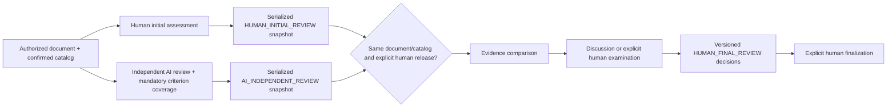

# Independent reviews

ThesisHounds supports the original PA1/PA2/BA second-review task through the existing
`AssessmentWorkflow`, `AISecondReviewer`, adaptive planner and policy-controlled gateway.

The AI branch receives a deep copy of the document and catalog, authorized local
knowledge/check outputs and its own bounded budget. No workflow record, human text,
import preview, expected human grade or final decision is passed into independent
planning, primary review or adversarial verification. Human submission may occur
before or during AI processing; both orders use the same disclosure gate.

Catalog selection now requires `profile_confirmed: true` on assessment creation.
Confirmation binds the full catalog, institutional-rule snapshot, document metadata,
document text and workflow mode. It does not promote an EXAMPLE/EXPERIMENT catalog
to an official DHBW rubric. Existing CANDIDATE/production restrictions still apply.

Human completeness checks use required IDs from the selected catalog, reject
duplicates/foreign IDs and blank observations/rationales, and permit omitted optional
criteria. Strengths, weaknesses, questions and references are optional. A concise
reasoned NOT_ASSESSABLE/NOT_APPLICABLE assessment is allowed; there is no word-count
threshold or forced criticism. This does not verify reading or scientific competence.

The existing local extractor provides JSON/YAML/PDF/DOCX human-review previews.
Only exact criterion IDs/descriptions are mapped. PDF/DOCX free text requires manual
structured completion; ambiguous or unrecognized material stays visible. No model
fills missing judgments. Preview never submits or releases a review. The final
submission must identify the current preview and explicitly confirm its review.
The development importer accepts only declared synthetic/authorized public test data;
the declaration is not a university authorization mechanism for confidential files.

Original snapshots are serialized values with content hashes. Later human corrections
belong in appended final decisions, feedback and notes, leaving the original intact.
There is no endpoint for rewriting an initial review. A changed document/catalog
requires a new assessment and independent reviews. Snapshots are RAM-only, not signed,
not archival and not recoverable after restart. Scoped retention/delete removes them.

AI abstention reasons include INSUFFICIENT_EVIDENCE, OUTSIDE_MODEL_COMPETENCE,
NOT_ASSESSABLE and MANUAL_REVIEW_REQUIRED and require NOT_ASSESSABLE judgment.
Lack of evidence is not an adverse evaluation. No score or overall-grade field is
enabled. Institution-approved scoring remains a future, separately reviewed feature.
