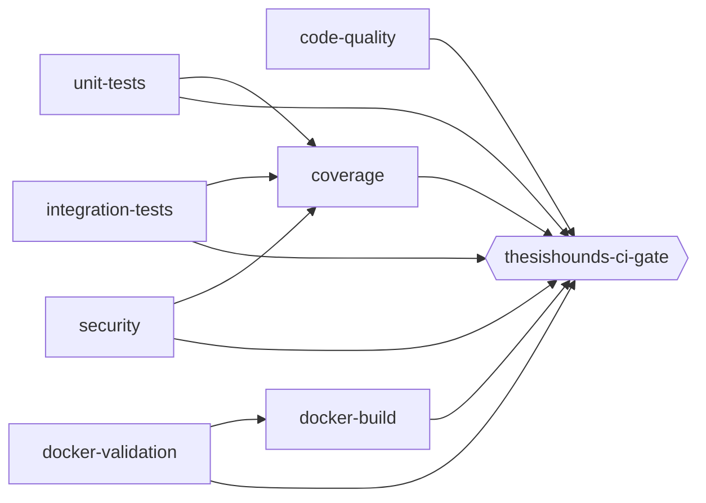

# CI/CD-Pipeline und Merge-Schutz

Die Pipeline in [`.github/workflows/ci.yml`](../.github/workflows/ci.yml) prüft jede Änderung, bevor sie in `main` gelangt. Verbindlich ist ein einziger Status Check: **`thesishounds-ci-gate`**. Er ist nur grün, wenn alle Pflicht-Jobs tatsächlich erfolgreich waren.

## Auslöser

| Ereignis | Verhalten |
| --- | --- |
| `pull_request` auf `main` (öffnen, neue Commits, reopen) | volle Pipeline; ein neuer Commit bricht den veralteten Lauf desselben PRs ab |
| `push` auf `main` | volle Pipeline, je Commit; wird nicht abgebrochen |
| `merge_group` | volle Pipeline für die Merge Queue, falls sie aktiviert wird |
| `workflow_dispatch` | manueller Start im Tab *Actions* |

`paths-ignore` wird bewusst nicht verwendet: Ein verpflichtender Check muss bei jedem PR berichten, sonst blockiert GitHub den Merge dauerhaft mit „Expected – waiting for status“.

## Jobs



| Job | Inhalt | Blockiert bei |
| --- | --- | --- |
| **code-quality** | `ruff check`, `ruff format --check`, `compileall` (Syntax) | jedem Lint-/Formatfehler, Syntaxfehler |
| **unit-tests** | `tests/unit`: Model Registry, Gateway, Provider, Agent Factory/Registry, Execution Engine, Validierung, Konfiguration, CI-Gate-Logik, Workflow-Policies | fehlgeschlagenem, fehlerhaftem oder **übersprungenem** Test |
| **integration-tests** | `tests/integration`: API, Control-API, Streamlit-Frontend ↔ Backend, vollständige LangGraph-Durchläufe A–D, Konflikte, Timeouts, Abbruch, fehlende Modelle, Compose-Netzisolation, Backend ↔ **Mock-Ollama über echtes HTTP** | wie oben |
| **security** | `tests/security`, Bandit, pip-audit, Gitleaks | siehe [Schwellen](#sicherheitsschwellen) |
| **coverage** | kombiniert die Coverage-Daten der drei Testjobs, XML + HTML + Terminal | Unterschreitung von `fail_under`, fehlenden Coverage-Daten |
| **docker-validation** | `docker compose config` für CPU, GPU, Provisionierung, CI-Mock; [`validate_docker.py`](../infrastructure/scripts/validate_docker.py); `docker buildx build --check` | ungültiger Konfiguration oder Regelverstoß |
| **docker-build** | baut Frontend, Backend und Ollama-Image, Trivy-Scan, Runtime-Smoke 1 (echtes Ollama-Image ohne Modell) und 2 (End-to-End mit Mock-LLM) | Buildfehler, Trivy-Befund über Schwelle, fehlgeschlagenem Smoke-Test |
| **thesishounds-ci-gate** | wertet alle Jobs und Testberichte aus | siehe unten |

Alle LLM-Aufrufe in der CI sind Mocks. Es wird kein Modell geladen, keine GPU benötigt und keine externe KI-API kontaktiert. Die GPU-Variante wird nur statisch validiert: Die Reservierung `driver: nvidia`, `capabilities: [gpu]` muss vorhanden sein, und zwar ausschließlich in `compose.gpu.yaml`.

### Mock-LLM-Service

[`tests/fixtures/mock_ollama.py`](../tests/fixtures/mock_ollama.py) implementiert `/api/tags`, `/api/ps`, `/api/show` und `/api/chat` der Ollama-API. Er antwortet mit derselben deterministischen Logik wie der `WorkflowProvider` der Tests. Antworten sind als `MOCK` gekennzeichnet, und der Dienst schreibt keine Request-Logs.

- In pytest läuft er in einem Thread: `tests/integration/test_mock_ollama_http.py`.
- In `docker-build` ersetzt [`compose.ci.yaml`](../compose.ci.yaml) den Ollama-Dienst durch den Mock. Dabei wird das Backend-Image wiederverwendet und es wird nichts gebaut.
- [`ci_e2e.py`](../infrastructure/scripts/ci_e2e.py) prüft dann aus den Containern heraus: Frontend-Health, Frontend → Backend, Backend → Mock, Chat, einen vollständigen synthetischen Lauf im Modus D mit dynamischen Subagenten bis zur menschlichen Prüfung sowie fehlenden Internetzugang des Backends.

## Quality Gate

`thesishounds-ci-gate` hängt per `needs` von allen sieben Jobs ab und läuft mit `if: always()`. Er schlägt fehl, wenn

- ein Pflicht-Job `failure`, `cancelled`, `skipped` oder kein Ergebnis hat,
- ein Testbericht (`junit-unit.xml`, `junit-integration.xml`, `junit-security.xml`) oder `coverage.xml` fehlt,
- ein Bericht 0 Tests, Fehlschläge, Fehler oder **übersprungene Tests** enthält,
- die Liste der Pflicht-Jobs leer ist oder nicht zu `needs` passt.

Die Logik steckt in [`ci_summary.py`](../infrastructure/scripts/ci_summary.py). Unit-Tests decken jeden dieser Fälle ab (`tests/unit/test_ci_scripts.py`). Zusätzlich prüft `tests/unit/test_ci_workflow.py` die Workflow-Datei selbst:

- Das Gate hängt von jedem Job ab.
- Es gibt kein `continue-on-error`.
- Jeder Job hat nur `contents: read`.
- Kein `pull_request_target`.
- Keine Secrets.
- Alle Actions sind auf Commit-SHAs gepinnt.
- `persist-credentials: false` ist gesetzt.

Wer das Gate abschwächt, bricht also selbst die Tests.

## Coverage

- Gemessen wird `backend/app`, `frontend` und `infrastructure/scripts`, mit Branch-Coverage.
- Nicht gemessen werden nur `run_ci.py`, `ci_e2e.py` und `smoke.py`. Sie steuern ausschließlich Docker bzw. Subprozesse und laufen im `docker-build`-Job.
- Grenzwert: **80 %** (`fail_under` in [`pyproject.toml`](../pyproject.toml)). Gemessen am 26.11.2026: **85,1 %** (Zeilen + Branches, alle Suites). Der Zielwert von 70 % aus der Aufgabenstellung ist damit überschritten. 80 % lassen Spielraum für neuen Code, ohne Rückschritte zuzulassen.
- Der Grenzwert wird nur schrittweise **erhöht**. Absenken, um eine rote Pipeline grün zu bekommen, ist unzulässig. Jede Änderung braucht einen eigenen, begründeten PR.

## Sicherheitsschwellen

| Werkzeug | Umfang | Blockiert | Nur Bericht |
| --- | --- | --- | --- |
| Bandit 1.9.4 | `backend/app`, `frontend`, `infrastructure/scripts` | Severity ≥ MEDIUM **und** Confidence ≥ MEDIUM | LOW (aktuell 14× `subprocess` mit festen Argumentlisten in Infrastruktur-Skripten) |
| pip-audit 2.10.1 | alle vier Lock-Dateien, ohne Installation | **jede** bekannte Schwachstelle (`--strict`) | – |
| Gitleaks 8.30.1 | gesamte Git-Historie, Ausgabe redigiert | **jedes** erkannte Secret | – |
| Trivy 0.76.2 | gebaute Images, OS- und Python-Pakete | Backend/Frontend: HIGH + CRITICAL mit verfügbarem Fix; Ollama-Image (Upstream-Basis): CRITICAL mit Fix | alle Schweregrade als JSON |
| Sicherheitstests | `tests/security` | jeder Fehlschlag | – |

Sicherheitstests decken ab:

- **LOCAL_ONLY:** Externe Provider werden blockiert, auch wenn sie registriert sind. Der Gateway ruft den Provider nachweislich nie auf.
- **Konfiguration:** EXPERIMENTAL und unbekannte Policy-Schalter werden abgelehnt, und die ausgelieferte Policy ist LOCAL_ONLY.
- **Werkzeuge:** Nicht freigegebene Tools werden verboten, auch wenn die Policy sie listet.
- **AgentSpec:** Die Validierung greift (Pfad-Traversal-IDs, Rollen, `can_delegate`, Schemas). Auch eine per `model_construct` umgangene Validierung wird abgefangen.
- **Limits:** Maximale Delegationstiefe, Supervisor- und Subagentenlimits gelten auch über mehrere Supervisoren hinweg. Für die Limits gibt es harte Obergrenzen.
- **Unkontrollierte Agentenerzeugung:** Ein vollständiger Lauf mit „flutendem“ Mock-Modell bricht ab, ohne das Limit zu überschreiten.

### Ausnahmen

Ausnahmen sind nur einzeln, begründet, befristet und per Review zulässig. Pauschale Ausnahmen für ganze Schweregrade, Pakete oder Images sind verboten.

- **Trivy:** Eintrag in [`.trivyignore`](../.trivyignore) mit Kommentar (Image, Paket, Begründung, PR) und `exp:JJJJ-MM-TT`.
- **pip-audit:** `--ignore-vuln <ID>` im Workflow-Schritt und in `run_ci.py`, jeweils mit Kommentar und Ablaufdatum.
- **Bandit:** `# nosec BXXX - Begründung` an der konkreten Zeile, niemals ohne Regel-ID.

Aktuell gibt es **keine** Ausnahmen. Die vorhandenen `nosec`-Marker betreffen das XML-Parsen selbst erzeugter CI-Berichte und die Bind-Adresse des Mock-Dienstes im internen Netz.

## Datenschutz und CI-Sicherheit

- Ausschließlich synthetische Daten: das serverseitige Demo-Dokument und Mock-Antworten. Echte Arbeiten, Prompts oder personenbezogene Daten gehören nie ins Repository, in Tests oder Issues. `.gitignore` und `.dockerignore` schließen Dokumentformate und Datenordner aus.
- `permissions: {}` auf Workflow-Ebene, jeder Job nur `contents: read`, Checkout mit `persist-credentials: false`.
- Kein `pull_request_target`, keine Secrets. Fork-PRs laufen ohne Schreibrechte.
- Drittanbieter-Actions sind auf geprüfte Commit-SHAs fixiert. Gitleaks und Trivy werden als Release-Archiv mit fest eingetragener SHA256-Prüfsumme geladen statt über Dritt-Actions. Alle Python-Abhängigkeiten werden mit `--require-hashes` installiert, die Scanner in einer getrennten venv.
- Container-Logs werden nur bei Fehlschlag ausgegeben und enthalten nur synthetische Daten. Backend und Mock protokollieren keine Inhalte, Gitleaks redigiert Funde.
- Tracing und Telemetrie (LangSmith, OpenTelemetry, Streamlit) sind in allen Jobs deaktiviert.

### Aktualisieren gepinnter Versionen

1. Neues Release prüfen (Changelog, Security Advisories).
2. Den Commit des Tags ermitteln: `git ls-remote https://github.com/<owner>/<action>.git "refs/tags/<tag>^{}"`.
3. SHA plus Kommentar `# vX.Y.Z` eintragen.
4. Für Gitleaks und Trivy Version und `*_SHA256` aus der offiziellen `checksums.txt` des Releases übernehmen.
5. Python-Locks mit `uv pip compile … --generate-hashes` neu erzeugen; der Befehl steht im Kopf jeder Lock-Datei.

## Testberichte und Artefakte

Alle Artefakte werden 14 Tage aufbewahrt und auch bei fehlgeschlagenen Tests hochgeladen, sofern sie erzeugt wurden:

| Artefakt | Inhalt |
| --- | --- |
| `unit-test-report` | `junit-unit.xml`, Coverage-Daten |
| `integration-test-report` | `junit-integration.xml`, Coverage-Daten |
| `security-scan-report` | `junit-security.xml`, `bandit.json`, `pip-audit.json`, `gitleaks.json` |
| `coverage-report` | `coverage.xml`, HTML-Bericht (`coverage/html/index.html`) |
| `docker-scan-report` | `trivy-backend.json`, `trivy-frontend.json`, `trivy-ollama.json` |

Jeder Job schreibt eine Job Summary mit Testzahlen, Coverage, Scannerbefunden bzw. Docker-Status. Das Gate fasst alles in einer Tabelle zusammen.

## GitHub Ruleset für `main`

**Status: vorbereitet, nicht aktiviert.** Die Workflow-Datei allein schützt `main` nicht. Erst das Ruleset blockiert Merges. `gh` war bei der Einrichtung nicht angemeldet, deshalb wurde nichts an den Repository-Einstellungen geändert.

Das Repository ist öffentlich, Rulesets sind deshalb ohne kostenpflichtigen Tarif verfügbar. Bei einem privaten Repository wären GitHub Pro, Team oder Enterprise nötig. Zum Anlegen sind Admin-Rechte am Repository erforderlich.

Payload: [`infrastructure/scripts/github_ruleset.json`](../infrastructure/scripts/github_ruleset.json).

| Anforderung | Ruleset-Regel |
| --- | --- |
| Keine direkten Pushes, nur PRs | `pull_request` |
| ≥ 1 Freigabe durch ein anderes Teammitglied | `required_approving_review_count: 1`, `require_last_push_approval: true` (wer zuletzt gepusht hat, kann nicht freigeben; eigene PRs sind bei GitHub grundsätzlich nicht freigebbar) |
| Veraltete Approvals verwerfen | `dismiss_stale_reviews_on_push: true` |
| Review-Konversationen auflösen | `required_review_thread_resolution: true` |
| `thesishounds-ci-gate` verpflichtend | `required_status_checks` mit `integration_id: 15368` (nur GitHub Actions darf diesen Status setzen) |
| Branch aktuell mit `main` | `strict_required_status_checks_policy: true` |
| Laufende, fehlende oder rote Checks blockieren | Standardverhalten von `required_status_checks` |
| Keine Force-Pushes | `non_fast_forward` |
| `main` nicht löschbar | `deletion` |
| Admins umgehen nicht standardmäßig | `bypass_actors: []` |

### Einrichtung per GitHub CLI (Admin)

```bash
gh auth login
# Vorhandene Rulesets prüfen – nichts überschreiben, ohne es abzustimmen:
gh api repos/HerrBubimann/ThesisHounds/rulesets
gh api repos/HerrBubimann/ThesisHounds/branches/main/protection   # klassische Regel vorhanden?
# Anlegen:
gh api repos/HerrBubimann/ThesisHounds/rulesets --method POST \
  --input infrastructure/scripts/github_ruleset.json
```

Der Status-Check-Name ist erst wählbar, nachdem die Pipeline einmal gelaufen ist. Deshalb zuerst den Workflow auf `main` bringen, dann das Ruleset anlegen.

### Manuelle Einrichtung (Web-UI)

*Settings → Rules → Rulesets → New ruleset → New branch ruleset*:

1. Name `main-protection`, Enforcement status **Active**, Bypass list **leer** lassen.
2. Target branches: **Include default branch**.
3. Aktivieren: **Restrict deletions** und **Block force pushes**.
4. **Require a pull request before merging** aktivieren, Required approvals **1**. Dazu **Dismiss stale pull request approvals when new commits are pushed**, **Require approval of the most recent reviewable push** und **Require conversation resolution before merging**.
5. **Require status checks to pass** aktivieren, außerdem **Require branches to be up to date before merging**. *Add checks* → `thesishounds-ci-gate`, Quelle **GitHub Actions**.
6. **Create** klicken.

Ergänzend unter *Settings → General → Pull Requests* **Automatically delete head branches** aktivieren. Die Merge Queue ist optional, der Workflow unterstützt `merge_group` bereits.

## Abnahmetest des Merge-Schutzes

Erst nach Aktivierung des Rulesets mit Admin-Rechten durchführen. Den absichtlich fehlerhaften Test **niemals mergen**.

```bash
git switch -c test/merge-protection
cat > tests/unit/test_merge_protection_canary.py <<'EOF'
def test_canary_must_fail():
    assert False, "intentional failure to verify merge protection"
EOF
git add tests/unit/test_merge_protection_canary.py
git commit -m "test: verify merge protection (do not merge)"
git push -u origin test/merge-protection
gh pr create --base main --draft --title "DO NOT MERGE: merge protection test" --body "Acceptance test, see docs/ci-cd.md"
```

1. `unit-tests` ist rot, `coverage` läuft trotzdem, `thesishounds-ci-gate` ist rot.
2. Im PR erscheint „Merging is blocked“. `gh pr merge --squash` wird abgelehnt.
3. Den Test korrigieren, z. B. `assert True`, committen und pushen. Der alte Lauf wird abgebrochen, der neue ist grün.
4. Ohne Approval bleibt der Merge blockiert. Nach Freigabe durch ein anderes Teammitglied und aufgelösten Kommentaren wird er möglich.
5. PR schließen **ohne Merge**, Branch löschen: `gh pr close --delete-branch`.

Ergebnis mit Datum in [`validation.md`](validation.md) festhalten.

## Fehlerbehebung

| Symptom | Ursache / Abhilfe |
| --- | --- |
| `code-quality` rot | Lokal `make format`, dann `make lint` |
| Test lokal grün, in CI rot | Lokale `.env` oder Docker-Abhängigkeit? Tests dürfen keine `.env` lesen (`Settings(_env_file=None, …)`). `make test` mit sauberem Checkout wiederholen. |
| „skipped (not allowed in CI)“ | Ein Test hat sich übersprungen, z. B. weil Docker fehlte. In der CI ist das unzulässig: Ursache beheben, nicht den Skip verstecken. |
| `coverage` rot | Tests für neuen Code ergänzen; `reports/coverage/html/index.html` zeigt fehlende Zeilen. |
| pip-audit-Befund | Paket in `requirements.txt` anheben, Lock neu erzeugen. Ohne Fix: Ausnahme nach obigem Verfahren. |
| Gitleaks-Befund | Secret sofort **widerrufen bzw. rotieren**, dann aus der Historie entfernen. Ein Folge-Commit allein reicht nicht. |
| Trivy-Befund | Basis-Image bzw. Paket aktualisieren (`python:3.12.x-slim-bookworm`, `ollama/ollama`). Sonst begründete, befristete Ausnahme. |
| `docker-build` Smoke rot | Abschnitt „Container status on failure“ im Log ansehen; lokal `make docker-smoke` |
| Gate rot, alle Jobs grün | Fehlender Bericht oder übersprungene Tests; die Gate-Summary nennt die Ursache. |
| Check „Expected – waiting“ im PR | Workflow lief nicht (z. B. Syntaxfehler in `ci.yml`): Tab *Actions* prüfen. |
