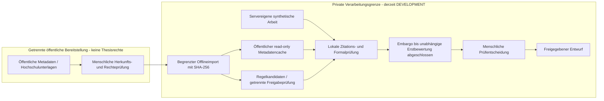

# Recherchegrenze

Öffentliche Quelle ≠ öffentliche Fragestellung. DOI-Listen, Zitationsmuster,
Forschungsfragen und Suchbegriffe aus einer vertraulichen Arbeit behalten deren
Schutzklasse, auch nach Kürzung/Anonymisierung. Eine UI-Bestätigung erlaubt keinen
externen Transfer dieser Ableitungen.

Der PRIVATE-Prozess hat ausschließlich lokale Teilbestände:

Keine Rückkante von V/H/F zur öffentlichen Bereitstellung. ResearchGateway besitzt
keinen HTTP-Client und lehnt jede externe Suche ab, auch selbstdeklarierte PUBLIC-
Suchanfragen. `LocalResearchCache.search` sucht nur in bereits importierten Titeln.
Der optionale Quellenqualitätsreview nutzt ausschließlich den vorhandenen lokalen
Gateway mit IFC, Rollen-/Modellfreigabe, Budgets und fehlendem externen Fallback.

Private Hochschulrichtlinien und das gegebenenfalls interne Palleduhn-Original dürfen
nicht im Git-/CI-/Dockerbestand landen. Ihr Import bleibt in DEVELOPMENT gesperrt.
Ein künftig erlaubter interner Bestand benötigt Hochschulidentität, gesonderte
Speicherrechte, Parserabnahme und Weitergabe der höchsten Schutzklasse in RAG/Embeddings.
Diese Infrastruktur ist noch nicht freigegeben. Öffentliche Snapshots sind kuratierte
Literaturbestände, keine Suchprotokolle aus vertraulichen Analysen.

Keine allgemeine Logausgabe enthält extrahierte Literatur, Prompts, Quelldateinamen
oder Gutachten. Import-CLIs geben nur Status/Zähler/Hash aus und unterdrücken rohe
Validierungs-/Parserfehler. Offlinebestände werden nicht automatisch aktualisiert;
Prüfzeitpunkt und unvollständige Rücknahmeabdeckung bleiben sichtbar.
