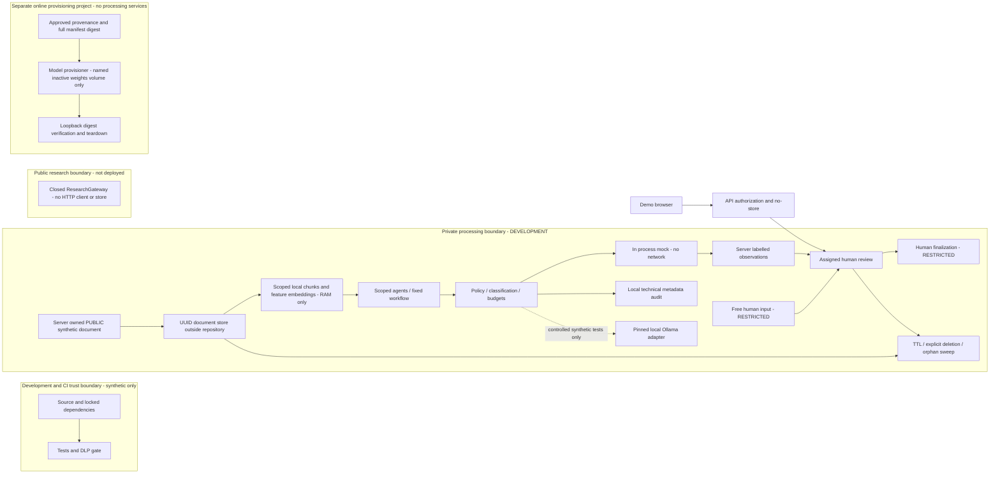

# Data flow and lifecycle

Ergänzung 27.11.2026: [Recherche-/Knowledge-Base-Datenfluss](../research/research_privacy.md).
Geprüfte öffentliche Dateien/Metadaten können offline in getrennte lokale Bibliotheken
importiert werden. Kein vertraulicher Rückfluss zur öffentlichen Beschaffung.
Formalien-/Quellenresultate bleiben bis nach der unabhängigen Erstbewertung gesperrt;
Bestätigungen liegen im gleichen geschützten Assessment-Lifecycle. Der optionale
GROBID-Entwurf ist noch nicht als echter Parser-/Hostnachweis abgenommen.

Keine Kante vom vertraulichen Bestand zur Recherche. Kein externer Modelladapter,
Embedding-/OCR-API oder automatischer Download existiert im Runtimepfad.
`ResearchGateway` lehnt selbst angeblich PUBLIC deklarierte Anfragen ab.
Öffentliche Ergebnisse dürfen künftig nach Herkunftsprüfung in die private Zone
importiert werden; vertrauliche Fragestellungen dürfen daraus nicht hinausfließen.

| Schritt | Tatsächlicher Datenort / Metadaten |
|---|---|
| Eingabe | Keine echten Uploads. Chat nur festes Testsignal; Aufgaben/Kriterien nur serverseitige Defaults. Freie menschliche Demoannotation bleibt im privaten Prozess. |
| Klassifizierung | Document default RESTRICTED, Fixture explizit PUBLIC; Sperrvermerk lokal. |
| Speicherung | Legacy-Fixture als UUID-JSON außerhalb des Repositorys; Assessment einschließlich Gutachten, Chat und Erstbewertung nur RAM. |
| Verarbeitung | Modell-/Agentenkontext durch serverseitige Label und erlaubte Dokumente begrenzt. Unabhängiger Review erhält keine menschliche Erstbewertung. |
| Weiterleitung | Default: keine Netzwerk-Inferenz. Kontrollierte Ollama-Tests über Gateway; niemals externe Provider. |
| Zwischenspeicherung | Begrenzte Run-/Assessment-/Agentenzahl; keine Vektordatenbank oder externe Caches. |
| Bibliografie/DOI | Kandidaten, Nennungen und Einträge behalten Klasse und Analyse-/Dokument-ID; Zusammenführung nutzt höchste Klasse. Quellenreview verweigert fremden Scope. |
| Ausgabe | Zuweisung und Rechte sowie Ergebnisembargo; Modelltext als Text, menschliche Finalisierung, höchste Schutzklasse. Keine Export-/Downloadroute freigegeben. |
| Protokollierung | Technische Auditmetadaten, keine Inhalte; Metriken, Laufzeiten und Tokenzähler. |
| Löschung | TTL, Shutdown, UUID-Orphan-Sweep, DELETE für Runs/Assessments. Host-Backups/Swap/Browser liegen außerhalb dieser Löschgarantie. |

Frontend→API wird an die geprüfte numerische Backend-IP gebunden. Requests werden
vor Zustandsänderungen auf 1 MiB und 15 Sekunden Body-Lesezeit begrenzt; Antworten
aus Backend-/Modelladaptern sind auf 8 MB begrenzt. Provisioning ist ausschließlich
für genehmigte Gewichte vorgesehen, hier mangels Freigaben nicht ausgeführt. Es hat
keinen Dokumentenmount; Runtime und Provisioning dürfen das Modell-Volume nicht
gleichzeitig verwenden. Operator-Parallelstarts benötigen unabhängige Betriebskontrollen.
