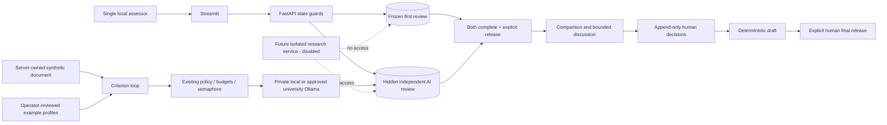

# Threat model and trust boundaries

Date: 2026-11-26. Scope: synthetic MVP plus explicit future research boundary.
Assets: thesis content, human first review, hidden AI findings, model credentials,
criterion provenance, human decisions and runtime budgets. Actors: reviewer,
document author, malicious retrieved content, compromised model artifact/service,
unauthorized client and operator. The trusted operator can change code/configuration;
this MVP does not defend against a compromised host or administrator.

The dashed edges denote forbidden access, not implemented connections. The current
ResearchGateway has no HTTP client, datastore reference or provider executor.

| Boundary | Enforcement / remaining limitation |
|---|---|
| Browser → API | Loopback UI, internal backend; strict Pydantic schemas; content rendered as text. No multi-user auth yet. |
| Human first review → AI context | AISecondReviewer accepts only document, profile, ID and budget; does not receive review/store/runtime. Discussion sees released reviews only. |
| Hidden AI → client | Separate store and explicit status projection; comparison/draft/discussion/decision routes guard release. Legacy `/runs` cannot read assessment IDs. |
| Document → instruction/tool authority | System/user separation, strict qualitative outputs, fixed orchestration; no tool execution in second reviewer/discussion. Prompt protections remain probabilistic. |
| App → inference | Exact university host allowlist, HTTPS/CA verification, secret server header, no redirects/proxy env; network/VPN/DNS ownership and server cloud disablement require IT controls. |
| Model → workflow state | Model returns observations only, cannot choose transitions, skip criterion loop, approve findings or finalize. |
| Decisions → final text | Human conclusion plus explicitly included findings only; discussion prose is not automatically included. |
| Public egress → confidential core | No runtime public provider; default-deny contract only. Future service must receive approved query objects without internal mounts, credentials or full contexts. |

Threat scenarios: identity manipulation and fake quote support; document instructions
to reveal prompts, issue unauthorized tools or force grades; source text carrying
indirect instructions; premature result disclosure via generic endpoints; manipulated
HF metadata; workload exhaustion; loss of volatile state. Security signals never
reduce academic judgments automatically. Hidden PDF text, white font, OCR, metadata,
image instructions and document anonymization remain unevaluated because this release
has no real PDF/DOCX ingress. Do not infer protection from not seeing those attacks
in text-only tests. Logs/errors must not record prompts, documents or bearer tokens.

Before real use: authenticate reviewer identity, authorize every assessment/document
and approved internal source, add durable transactional state and audit integrity,
review parser sandboxing/deletion, enforce university egress at the network boundary,
and conduct adversarial tests with approved data. See PROD-1/RES-1 and risk register.
